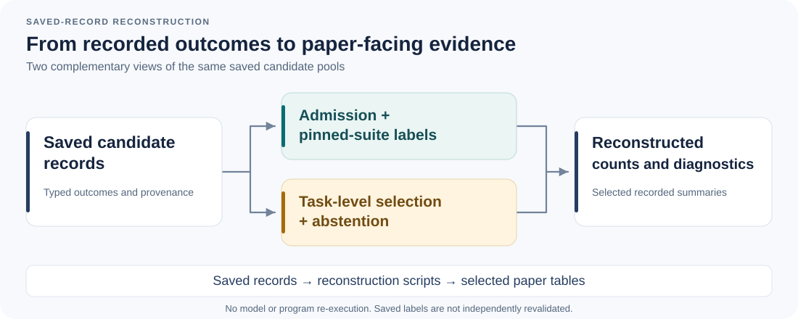
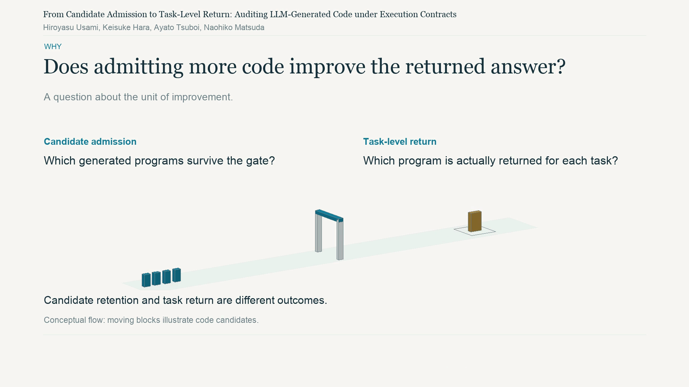

# Code Evidence Gates

### From Candidate Admission to Task-Level Return

**Auditing LLM-Generated Code under Execution Contracts**

A research artifact for tracing how **candidate admission** relates to the **candidate returned for a task**. It provides saved outcome records, reconstruction scripts, and file-level provenance for selected tables and diagnostics in the companion manuscript.

[Video overview](#research-overview-video) · [Quickstart](#quickstart) · [Table guide](#from-paper-tables-to-files) · [Repository map](#repository-map) · [Scope](#what-this-artifact-reconstructs) · [Integrity and licenses](#integrity-and-licenses)



## The question

An admission rule decides **which generated candidates are retained**. A selection policy decides **which retained candidate is returned for a task**, or whether the policy abstains. These are different units of evidence: retaining additional passing candidates need not change a policy's task-level outcome.

This artifact connects the two views within saved candidate pools from two separately frozen cohorts. Readers can inspect:

- **Admission accounting:** retained candidates that do not pass the pinned suite, and excluded candidates that do.
- **Task-level return:** first-admitted outcomes, abstentions, and order-sensitive selection summaries.
- **Selected rejection diagnostics:** exception/registration counts and recorded assertion-output pairs, with domain and comparator-policy distinctions.

The figure describes the reconstruction workflow, not a new model-generation or program-execution pipeline.

## Research overview video

[](media/Execution_Contracts_Research_Overview_Silent_1080p.mp4)

**Silent · approximately 1:53 · 1080p · English on-screen text.** Click the thumbnail to open the [MP4 in this repository](media/Execution_Contracts_Research_Overview_Silent_1080p.mp4).

**Why it matters:** admitting more suite-passing candidates need not improve task-level return. The video explains this distinction for the studied saved candidate pools, a fixed first-admitted selector, and a pinned independent test suite. Its moving blocks are illustrative, not additional measured samples. The findings do not establish a universal performance effect or downstream training improvement.

The overview and its actual-frame thumbnail are explanatory documentation, not new experiments. For the full study and its exact artifact version, refer to the manuscript and the pinned artifact snapshot.

## Quickstart

### 1. Obtain the manuscript-cited snapshot

```bash
git clone https://github.com/usamihiroyasu/code-evidence-gates.git
cd code-evidence-gates
git checkout --detach 3425b76a8b091415fbe140eb845ea887203f61ca
```

The manuscript-cited [artifact snapshot](https://github.com/usamihiroyasu/code-evidence-gates/tree/3425b76a8b091415fbe140eb845ea887203f61ca) remains fixed. The latest README, explanatory figure, and video overview are documentation updates; use the pinned snapshot when checking the manuscript's exact artifact version.

### 2. Check the requirements

The reconstruction scripts use the **Python standard library**, including SQLite JSON functions. The recorded successful aggregation check used **CPython 3.11.6**. No model API, model weights, or GPU is needed for these saved-record reconstructions.

This interpreter version describes the reconstruction check, not every original generation or evaluation stage. Original stage-specific information is retained in [experiment metadata](core/EXPERIMENT_METADATA.json).

### 3. Run the reconstruction you need

Run from the repository root. Choose **new output filenames**: the file-writing entrypoints do not overwrite existing outputs.

**Core candidate and task-level accounting**

```bash
python3 -I -B core/aggregate_reviewed.py --output NEW_CORE_RESULT.json
```

**Exception, registration, and assertion-status diagnostics**

```bash
python3 -I -B diagnostics_5_14/aggregate_diagnostics.py
```

This command prints its result to standard output.

**Saved assertion-output pairs and comparator-policy diagnostics**

```bash
python3 -I -B diagnostics_13/reconstruct_table13_candidate.py \
  --input diagnostics_13/TYPED_PAIRS.json \
  --input-sha256 6038514deb8714f4bc63d9195da9e58f2a7353ec1d62e40d7d5ae476faf55cf5 \
  --output NEW_TABLE13_RESULT.json
```

### What a successful reconstruction looks like

| Command | Output | Where to compare |
| --- | --- | --- |
| Core aggregation | A new JSON file; a console summary with `status: SAVED_LABEL_AGGREGATE_ONLY` | [Saved core result](core/ACTUAL_RESULT.json), [expected saved summaries](core/EXPECTED_SAVED_RESULTS.json), and the [table-to-file map](core/TABLE_TO_FILES.json) |
| Tables 5/14 diagnostics | JSON on standard output, including `saved_aggregate_match` | [Saved diagnostic result](diagnostics_5_14/RESULT.json) and [recorded totals](diagnostics_5_14/recorded_totals.json) |
| Table 13 reconstruction | A new JSON file; a console summary with `status: RECONSTRUCTED_SAVED_PAIR_POLICY` | [Saved Table 13 reconstruction](diagnostics_13/RECONSTRUCTED_TABLE13.json) and [input pairs](diagnostics_13/TYPED_PAIRS.json) |

An integrity error or disagreement should be investigated, not resolved by modifying the saved inputs. These checks concern reconstruction of the supplied records, not independent validation of the original experimental labels.

## From paper tables to files

Table numbers below follow the companion manuscript's artifact map.

| Paper evidence | Supplied records and mapping | Entrypoint / result keys |
| --- | --- | --- |
| Tables 2, 4, and 6: candidate accounting | [Original-cohort rows](core/admission_ablation/v9_rows.jsonl), [follow-up rows](core/admission_ablation/v11_rows.jsonl) | [Core aggregation](core/aggregate_reviewed.py): `tables_2_4_6` |
| Table 3: full-contract accounting | [Planned rows](core/full_contract/planned_rows.jsonl), [journal](core/full_contract/journal.jsonl), [fixture identities](core/full_contract/ACTUAL_FIXTURES.json) | Core aggregation: `table_3` |
| Table 7: task-level selection | [Selection definitions](core/selection_replay/analyze.py), [protocol](core/selection_replay/PROTOCOL.md), and both cohorts' saved rows | Core aggregation: `table_7` |
| Table 9: common-order sensitivity | Full-contract planned rows, journal, and expected saved summaries | Core aggregation: `table_9` |
| Tables 5 and 14: selected rejection diagnostics | [Exception labels](diagnostics_5_14/inline_labels.json), [registration labels](diagnostics_5_14/registration_labels.json), and profile-specific assertion labels | [Diagnostic aggregation](diagnostics_5_14/aggregate_diagnostics.py) |
| Table 13: selected assertion-output pairs | [Typed pairs](diagnostics_13/TYPED_PAIRS.json), with pinned domain/comparison rules | [Pair reconstruction](diagnostics_13/reconstruct_table13_candidate.py) |
| Table 15: derivable cross-cells only | Original-cohort admission rows; see [qualification](core/TABLE_TO_FILES.json) | Core aggregation: `tables_2_4_6`; not a new native audit |

Use the [machine-readable table map](core/TABLE_TO_FILES.json) for the core input/result bindings. The two diagnostic packs have their own [input manifest](diagnostics_5_14/INPUT_MANIFEST.json) or explicitly hash-pinned pair input.

> [!NOTE]
> `core/selection_replay/analyze.py` is a library dependency here, **not a standalone entrypoint**. Use `core/aggregate_reviewed.py` for the supplied reconstruction.

## Repository map

```text
core/
  aggregate_reviewed.py          Core reconstruction entrypoint
  TABLE_TO_FILES.json            Paper-table → input/result map
  ACTUAL_RESULT.json             Preserved core reconstruction result
  EXPECTED_SAVED_RESULTS.json    Saved comparison summaries
  admission_ablation/            Recorded candidate-level accounting
  full_contract/                 Planned rows, journal, fixture identities
  selection_replay/              Selection definitions and protocol
  rights/                        Upstream license notices
diagnostics_5_14/                 Exception/registration/assertion records
diagnostics_13/                   Saved output pairs and policy reconstruction
assets/research-overview.png      Actual-frame thumbnail for the video overview
media/                           Silent research overview MP4
MANIFEST.json                    File-level sizes and SHA-256 hashes
FILE_PROVENANCE_AND_RIGHTS.json   File-specific origin and license scope
CODE_EQUIVALENCE.json             Historical/current script-header binding
```

The [original release notes](README.txt) remain available alongside this reader-oriented guide.

## What this artifact reconstructs

| Included | Outside this reconstruction |
| --- | --- |
| Selected saved-record counts, task-selection summaries, and rejection diagnostics | New model generation or execution of candidate/reference programs |
| Recorded input identities, file hashes, table mappings, and retained result files | Re-running native suites or recomputing bootstrap intervals |
| Explicit fixture membership and retained unsupported/missing bindings | Independent authentication of the original label derivation |
| Saved assertion-output pairs with domain/comparator-policy accounting | Raw problem text and executable implementation/self-test bodies |

For Table 13, classifications are reconstructed from saved pairs and pinned rules; they are not presented as historically serialized labels or new observations. Unsupported records and absent reference bindings remain explicit in the diagnostic materials.

The original-cohort and follow-up records, selected diagnostic populations, and historical controls retain their own identities. The files do not turn these populations into additional independent replications. See the [core notes](core/README.txt) and [source bindings](core/SOURCE_BINDINGS.json) for the stage-specific qualifications.

## Integrity and licenses

- [Root manifest](MANIFEST.json): sizes and SHA-256 hashes of delivered files other than the manifest itself.
- [Core input manifest](core/INPUT_MANIFEST_REVIEWED.json): the core entrypoint's required input pins.
- [Core package manifest](core/PACKAGE_MANIFEST.json): the preserved core package, including its saved result.
- [Code equivalence record](CODE_EQUIVALENCE.json): historical/current header edits and unchanged computational ASTs. Historical driver hashes inside saved results are retained.
- [File provenance and rights](FILE_PROVENANCE_AND_RIGHTS.json): origin and applicable notice/license scope for each file.

**Author-contributed code:** [MIT](LICENSE_CODE_MIT.txt). **Author-created data and documentation:** [CC BY 4.0](LICENSE_DATA_DOCS_CC_BY_4.0.txt). Third-party materials retain their original terms and [notices](core/THIRD_PARTY_NOTICES.txt); upstream notice copies do not relicense other contributions.

## Companion manuscript and questions

**From Candidate Admission to Task-Level Return: Auditing LLM-Generated Code under Execution Contracts**  
Hiroyasu Usami, Keisuke Hara, Ayato Tsuboi, and Naohiko Matsuda.

Public preprint: [arXiv:2610.24609](https://arxiv.org/abs/2610.24609) · [PDF](https://arxiv.org/pdf/2610.24609).

```bibtex
@misc{usami2026candidateadmission,
  title = {From Candidate Admission to Task-Level Return: Auditing {LLM}-Generated Code under Execution Contracts},
  author = {Usami, Hiroyasu and Hara, Keisuke and Tsuboi, Ayato and Matsuda, Naohiko},
  year = {2026},
  eprint = {2610.24609},
  archivePrefix = {arXiv},
  url = {https://arxiv.org/abs/2610.24609}
}
```

When referring to this artifact, include the repository URL and the [fixed artifact commit](https://github.com/usamihiroyasu/code-evidence-gates/tree/3425b76a8b091415fbe140eb845ea887203f61ca). Documentation updates do not replace that manuscript-cited snapshot.

For a reproducibility question, please [open an issue](https://github.com/usamihiroyasu/code-evidence-gates/issues) with the artifact commit, Python/SQLite versions, command, and relevant output or error. Please omit credentials and non-public data.
